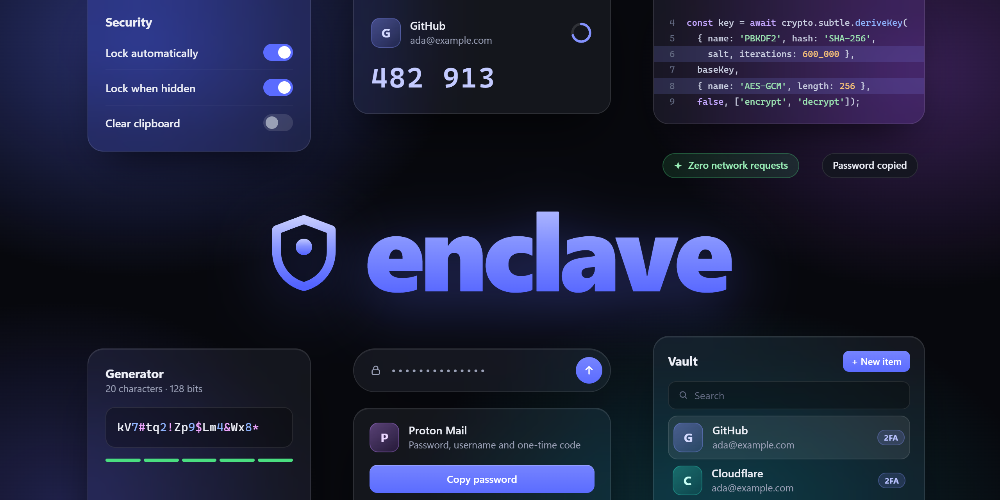
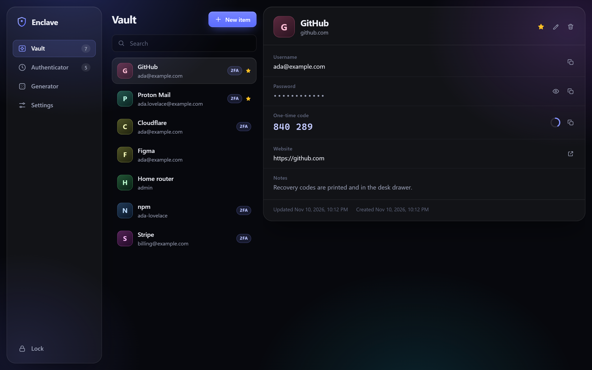
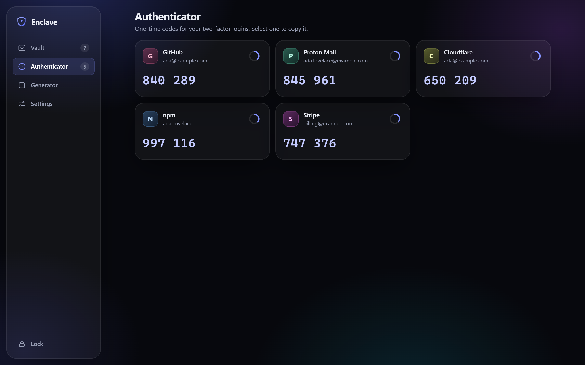
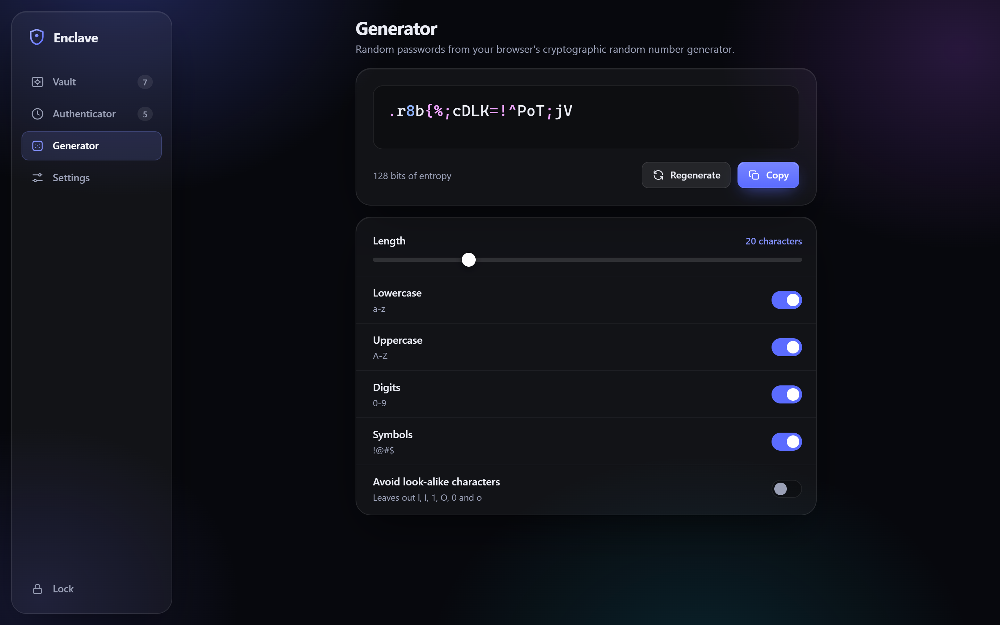
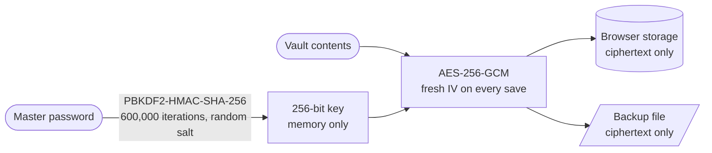

<div align="center">



# Enclave

A local-first password vault and authenticator that encrypts everything in your browser: <br/>
no server, no account, and nothing ever sent anywhere.

**Currently in Beta** · Built on [React 19](https://react.dev) and the
[Web Crypto API](https://developer.mozilla.org/docs/Web/API/Web_Crypto_API)

[](package.json)
[](LICENSE)
[](https://github.com/TomFleuren/Enclave/actions/workflows/ci.yml)
[](CONTRIBUTING.md)

[](docs/vault-format.md)
[](docs/vault-format.md#deriving-the-key)
[](#security-model)

**[Getting started](#getting-started)** · **[Security model](#security-model)** ·
**[Vault format](docs/vault-format.md)** · **[Contributing](CONTRIBUTING.md)** ·
**[Report a vulnerability](SECURITY.md)**

</div>

## Overview

Enclave is a password manager and two-factor authenticator that runs entirely in a browser tab.
You choose a master password, and everything you store is encrypted with a key derived from it
before it is saved. There is no backend to trust, breach or shut down, because there is no backend.

It keeps logins, passwords, notes and authenticator keys together, shows live one-time codes,
generates strong passwords, locks itself when you step away, and exports encrypted backups you can
keep wherever you like.

**What makes Enclave different:**

- **Nothing leaves the browser.** There is no server, no sync, no telemetry and no account. The
  production build ships with a Content-Security-Policy of `connect-src 'none'`, so the page is not
  able to open a network connection even if it tried.
- **Standard cryptography, used plainly.** Encryption is AES-256-GCM and key derivation is
  PBKDF2-HMAC-SHA-256 at 600,000 iterations, both from the browser's built-in Web Crypto API.
  Enclave implements no cryptographic primitive itself and pulls in no crypto library.
- **One runtime dependency.** React. One-time codes, base32, the password generator and the icons
  are all a few hundred readable lines in this repository, not packages from somewhere else.
- **An open, documented format.** A vault is a small JSON file described in full in
  [docs/vault-format.md](docs/vault-format.md). A stand-alone script decrypts it without Enclave, so
  your data is never locked into this app.

<div align="center">

</div>

| Authenticator | Generator |
| :-----------: | :-------: |
|  |  |

<sub>Screenshots show the built-in demo vault. Every account, password and code in them is made up.</sub>

## Features

- **Vault.** Logins with username, password, website, notes and an authenticator key. Search,
  favourites, and one-click copy for every field.
- **Authenticator.** Time-based one-time codes (TOTP, RFC 6238) with SHA-1, SHA-256 and SHA-512,
  6 to 8 digits and any period. Paste a secret key or a whole `otpauth://` link.
- **Password generator.** 8 to 64 characters from the browser's cryptographic random number
  generator, with no modulo bias, and an entropy readout.
- **Auto-lock.** Locks after a period of inactivity, and optionally the moment the tab is hidden.
  Locking discards the key and the decrypted contents.
- **Clipboard clearing.** Copied passwords and codes are wiped from the clipboard after a delay you
  choose.
- **Encrypted backups.** Export the vault as a file and restore it in any browser. A backup is
  only restored once its password has successfully decrypted it.
- **Master password change.** Re-encrypts the vault under a new key and a new salt.
- **Responsive.** The layout adapts down to phone-sized screens.

## Getting Started

Enclave needs **Node.js 22.13 or later** to build and a current browser to run. It is developed
and tested in Chromium-based browsers (Chrome and Edge).

```bash
git clone https://github.com/TomFleuren/Enclave.git
cd Enclave
npm install
npm run dev
```

Open the address the dev server prints and create a vault. To look around first, add `#demo` to
that address for an in-memory vault filled with made-up items; it exists only in development.

To build it for real use:

```bash
npm run build
```

That produces a fully static site in `dist/` that can be served by any static host or opened with
`npm run preview`. Two things matter when hosting it:

- **Serve it over HTTPS** (or from `localhost`). Browsers only expose the Web Crypto API on secure
  origins.
- **Give it an origin of its own.** The encrypted vault is kept in that origin's storage, so
  anything else served from the same origin can read or delete the ciphertext.

### Scripts

| Command            | What it does                                                    |
| ------------------ | --------------------------------------------------------------- |
| `npm run dev`      | Start the dev server                                            |
| `npm run build`    | Typecheck and build into `dist/`                                |
| `npm run preview`  | Serve the production build locally                              |
| `npm test`         | Unit tests                                                      |
| `npm run test:e2e` | Drive the production build through a real browser               |
| `npm run check`    | Typecheck, lint, unit tests and build                           |

## Security model



| Part                 | What Enclave does                                                                    |
| -------------------- | ------------------------------------------------------------------------------------ |
| Key derivation       | PBKDF2-HMAC-SHA-256, 600,000 iterations, 16-byte random salt per master password     |
| Encryption           | AES-256-GCM with a 12-byte random IV per save; the header is authenticated too       |
| Key handling         | A non-extractable `CryptoKey`, held in memory while unlocked, never written anywhere |
| Storage              | One `localStorage` entry holding the encrypted vault and nothing else                |
| Network              | None. Enforced by `connect-src 'none'` in the production build                       |
| Randomness           | `crypto.getRandomValues` for salts, IVs and generated passwords                      |

**What this protects.** Someone who gets a copy of your stored vault or a backup file, from a
stolen laptop, a synced browser profile or a leaked backup, has only ciphertext. Getting anything
out of it means guessing the master password, with every guess costing 600,000 rounds of hashing.
A file whose encrypted data or parameters have been altered refuses to decrypt.

**What it cannot protect.** It is worth being plain about the limits:

- **Your device has to be trustworthy.** Malware, a keylogger or a malicious browser extension can
  read the vault while it is unlocked, or capture the master password as you type it.
- **The master password is everything.** There is no recovery and no reset. PBKDF2 slows guessing
  down but is not memory-hard, so a short or reused password can still be cracked offline. Use a
  long one that you use nowhere else.
- **You are trusting whoever serves the page.** A web app is downloaded again each time you open
  it. Run Enclave from a host you control, or locally, rather than from someone else's copy.
- **Browser storage is not permanent.** Clearing site data deletes the vault. There is no sync;
  the backup file is how you move or safeguard it. Export one regularly.
- **Clearing secrets is best effort.** JavaScript cannot guarantee that memory is wiped on lock,
  and the clipboard can only be cleared while the tab has focus. A clipboard manager may keep its
  own copy.
- **It has not been audited.** Enclave is in beta and has had no independent security review.

The precise format, including how to decrypt a vault by hand, is in
[docs/vault-format.md](docs/vault-format.md). To report a problem, see [SECURITY.md](SECURITY.md).

## Testing

Because the point of the project is that the cryptography is right, that is where the tests
concentrate.

- **Known-answer tests.** One-time codes are checked against the published test vectors of
  RFC 4226 and RFC 6238 for all three hash algorithms, and base32 against RFC 4648.
- **Independent decryption.** A vault written by the app is decrypted by a separate implementation
  built on `node:crypto`, which pins the stored format to its documentation.
- **Tamper tests.** Flipping a bit in the ciphertext, the IV, the salt or the iteration count must
  make decryption fail.
- **End to end.** `npm run test:e2e` builds the app and drives it in a real browser: creating a
  vault, reloading, unlocking, copying, exporting, changing the master password, restoring a
  backup, auto-locking. It fails if a secret appears in storage or in a backup, if the page logs an
  error, or if anything trips the Content-Security-Policy.

## Project Structure

| Directory         | Purpose                                                              |
| ----------------- | -------------------------------------------------------------------- |
| `src/crypto/`     | Key derivation, encryption, one-time codes and password generation   |
| `src/vault/`      | The vault data model, storage and backups                            |
| `src/state/`      | The vault session, toasts and clipboard handling                     |
| `src/screens/`    | Setup, unlock and the unlocked workspace                             |
| `src/views/`      | Vault, authenticator, generator and settings                         |
| `src/components/` | Shared UI pieces and the icon set                                    |
| `scripts/`        | End-to-end test, screenshot capture and stand-alone decryption       |
| `docs/`           | Vault format, banner source and screenshots                          |

`src/crypto` and `src/vault` contain no UI code and are the place to start reading.

## Contributing

Contributions are welcome. See **[CONTRIBUTING.md](CONTRIBUTING.md)** for how to get set up, the
checks to run and the ground rules that keep the project trustworthy: no network access, no new
runtime dependencies without good reason, and no home-made cryptography.

Please report security problems privately, as described in **[SECURITY.md](SECURITY.md)**, rather
than in a public issue.

## License

MIT
